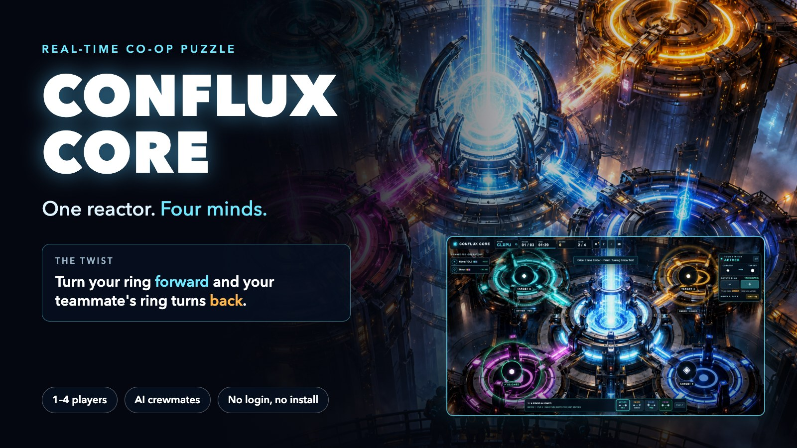

# CONFLUX CORE — Submission

Entry for the Handshake AI Skills Studio "Create a Multiplayer Game" mission (OpenAI). Deadline: **Oct 30, 2026, 11:59 PM PT**.

The entry form asks for four things: title, cover image, description and link. Each is below, ready to paste.

---

## a. Project title

```
CONFLUX CORE — One Reactor. Four Minds.
```

## b. Project cover image



Upload `conflux_cover_image.jpg` from this folder: the reactor key art with the title, the core mechanic and a real gameplay screenshot (1600 × 900).

## c. Project description

**Short version** (use this if the form limits length):

```
Play alone right now: tap Quick Play and an AI crewmate joins you. CONFLUX CORE is a real-time co-op puzzle for 1–4 players. Your crew runs four reactor stations linked in a ring, and every turn you make pushes the next station the other way, so nobody can solve their part alone. Plan together, beat the clock and match par across three rounds. Join from any phone or laptop with a five-letter code: no login, no install.
```

**Full version:**

```
Play alone right now: enter a callsign, tap Quick Play, and an AI crewmate takes its own stations while you handle yours.

CONFLUX CORE is a real-time cooperative puzzle for 1–4 players. Your crew runs four reactor stations linked in a ring around a collapsing energy core. Turning your station forward pushes the next station backward, so one player's fix can undo a teammate's work. Nobody can solve their part alone: you have to talk, plan the order and move together.

Each round, every ring must reach its target symbol before the clock runs out. Three rounds get harder and shorter: 90, 80, then 70 seconds. Every round has a par, the fewest moves possible, worked out by an optimal solver. Crews score on speed and efficiency, and hints help new players at a cost of 75 points.

Why it matters: the puzzle can't be finished by the fastest player working alone. It rewards communication and planning, so it works as a quick icebreaker for friends, classrooms and remote teams.

Details:
• Create a room and share a five-letter code or invite link. Friends join from a phone or laptop in seconds, even mid-game.
• Live symbols on every ring show each station's current and target state.
• Add up to three AI crewmates to fill empty seats.
• Crew chat, sound, keyboard shortcuts and an in-game how-to-play card.
• A cinematic arena, plus an optional real-time 3D view.
• Rejoin after a refresh or dropped connection; if the host leaves, the role hands over automatically.
```

## d. Project link

```
https://conflux-core.onrender.com
```

Source: https://github.com/TheSoftNode/conflux-core

---

## Quick start for a judge (about 3 minutes)

1. Open the link, type a callsign, tap **QUICK PLAY · YOU + AI CREW**.
2. Select one of your stations by tapping its ring or its chip at the bottom of the screen.
3. Tap **−** or **+** to turn it toward its target symbol. Watch the linked station: it turns the opposite way.
4. Keep going with your AI crewmate until all four rings match their targets. Tap **HINT −75** if you get stuck.
5. Clear all three rounds to see your final summary and rank.

To try real multiplayer, tap **CREATE ROOM** instead, then open the invite link on a second device.

## Before you submit

- [ ] Open the live link. If it takes about a minute the first time, a free instance was asleep; use an always-on plan or an uptime monitor.
- [ ] Play one full run on the live link, on a phone and on a laptop, with someone on a different network.
- [ ] Confirm the eligibility requirement: the entry must be a project built with the OpenAI "Create a Multiplayer Game" mission in Handshake. Be ready to explain how you built it.
- [ ] Paste the title, upload the cover, paste the description (short or full), paste the link.
- [ ] Submit before Oct 30, 2026, 11:59 PM PT, and save the confirmation.
